# Docker 개발 워크스테이션 구축 및 검증

> 실습일: 2026-11-14  
> 실습 환경: Windows · PowerShell · VS Code · Docker Desktop · Git  
> 확인 범위: 로컬 웹 서버 실행, Docker 이미지/컨테이너, 포트, 로그, 볼륨, Git 커밋

## 1. 프로젝트 개요

### 1.1 프로젝트 목적

본 프로젝트는 Windows PowerShell 환경에서 Docker와 Git을 사용하여 재현 가능한 개발 환경을 구성하고 그 작동을 검증하는 실습이다. Dockerfile을 통해 Nginx 이미지를 빌드하고 컨테이너를 실행하여 웹 접속과 포트 매핑을 검증한다. 별도의 Docker 볼륨을 이용해 임시 컨테이너 삭제 후에도 데이터가 유지되는지 확인하고, 발생한 문제의 원인과 해결 과정을 기록한다.

### 1.2 수행 내용

- VS Code와 PowerShell 작업 디렉터리 준비
- Docker Desktop 엔진 연결 확인과 장애 해결
- Dockerfile, `index.html` 작성 및 이미지 빌드
- 컨테이너 실행, 포트 연결, HTTP 로그 검증
- Docker 볼륨의 데이터 유지 확인
- Git 저장소 초기화, 파일 등록 및 첫 커밋
- 실행 화면과 트러블슈팅 증빙 정리

## 2. 실행 환경

| 항목 | 확인 내용 |
|---|---|
| 호스트 운영체제 | Windows (정확한 에디션은 별도 확인 필요) |
| 개발 도구 | Visual Studio Code |
| 터미널/셸 | PowerShell |
| Docker 클라이언트/서버 버전 | 29.9.2 |
| Docker 실행 환경 | Docker Desktop · Linux 컨테이너 (WSL2 커널 사용) |
| Git 버전 | `2.56.0.windows.4` |
| 웹 서버 기반 이미지 | `nginx:alpine` |
| 프로젝트 디렉터리 | `docker-workspace` |

Docker 클라이언트만 보이던 시점에는 서버 연결이 실패했고, Docker Desktop을 시작한 뒤 같은 명령어에서 Server 정보가 출력되었다.

**오류 당시 화면**

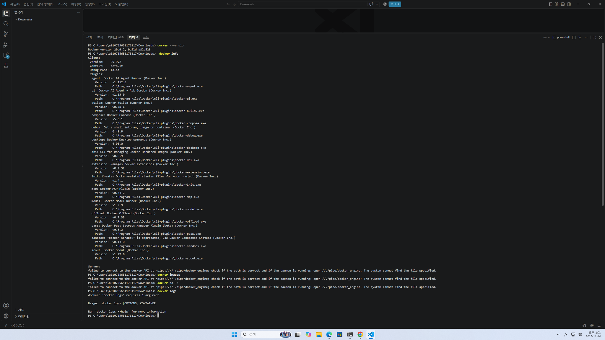

**해결 후 `docker info` 화면**

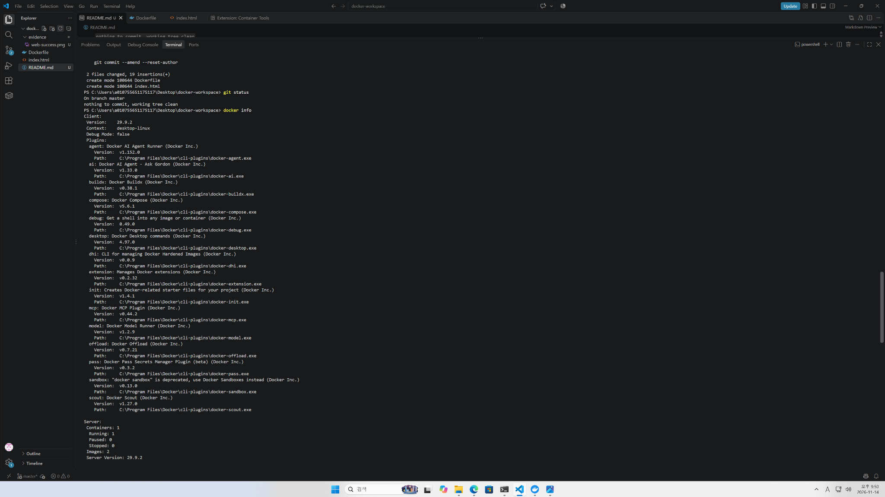

## 3. 수행 항목 체크리스트

- [x] PowerShell 터미널에서 프로젝트 폴더 확인 (`pwd`)
- [x] Docker 버전 및 서버 연결 확인 (`docker info`)
- [x] Dockerfile과 웹페이지 파일 작성
- [x] 이미지 빌드 완료
- [x] 컨테이너 생성 및 웹페이지 접속 성공
- [x] 포트 `8080:80` 연결 확인
- [x] Nginx 접근 로그 HTTP 200 확인
- [x] Docker 볼륨 생성과 컨테이너 간 데이터 유지 확인
- [x] 장애 발생/원인 확인/조치/재검증 문서화
- [x] Git 저장소 초기화 및 첫 커밋
- [ ] 호스트·컨테이너 파일 권한 실습 결과 추가 검증
- [ ] GitHub 원격 저장소 생성 및 업로드
- [ ] 다른 PC 또는 클린 환경에서 재현성 재검증

## 4. Docker 웹 서버 구축 및 검증

### 4.1 Dockerfile 작성

프로젝트 루트의 `Dockerfile`:

```dockerfile
FROM nginx:alpine
COPY index.html /usr/share/nginx/html/index.html
EXPOSE 80
```

`FROM`은 기반 이미지를 설정하고, `COPY`는 빌드 시 웹페이지를 이미지 내부 경로로 복사한다. `EXPOSE 80`은 컨테이너에서 사용할 포트를 문서화하지만, 호스트 포트 연결을 자동으로 만들지는 않는다.

### 4.2 이미지 빌드

```powershell
docker build -t my-nginx .
```

실제 출력에서 `Building ... (8/8) FINISHED`와 `my-nginx:latest` 이름 부여를 확인했다.

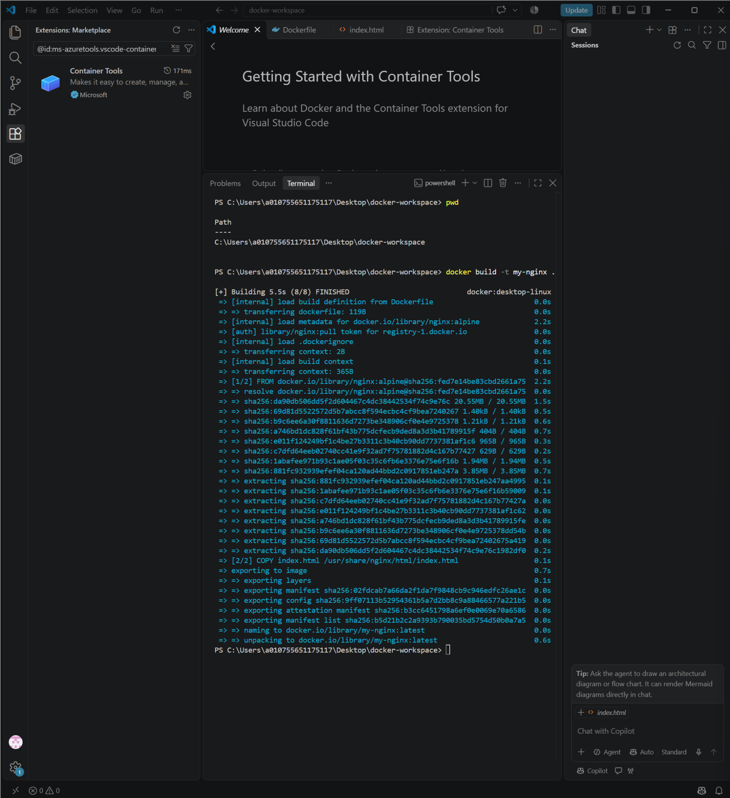

### 4.3 컨테이너 실행 및 포트 확인

```powershell
docker run -d --name my-web -p 8080:80 my-nginx
docker ps
```

`-d`는 백그라운드 실행, `--name`은 컨테이너 이름 지정, `-p 8080:80`은 호스트의 8080번 포트를 컨테이너의 80번 포트와 연결한다. `docker ps`에서 `my-web`이 `Up` 상태이고 포트가 `8080->80/tcp`로 표시되었다.

브라우저에서 `http://localhost:8080`에 접속해 **“Docker 웹 서버 실행 성공!”** 문구를 확인했다.

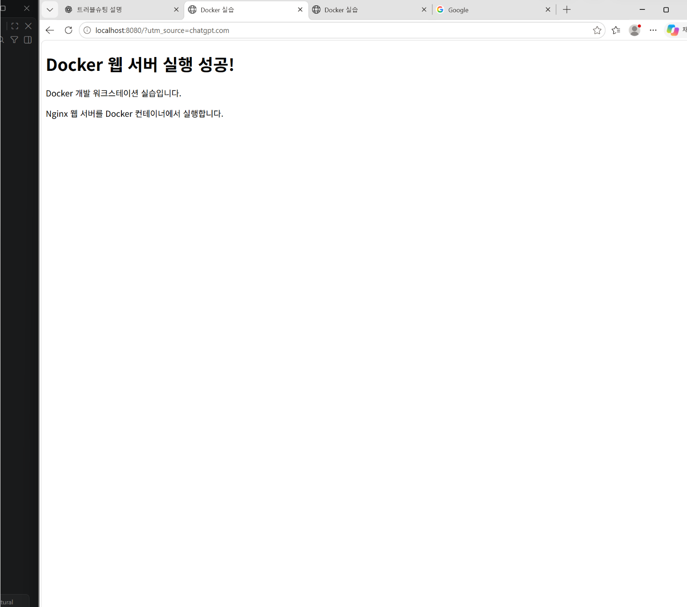

### 4.4 컨테이너 로그 검증

```powershell
docker logs my-web
```

접근 로그의 `GET /?... HTTP/1.1" 200`에서 HTTP 응답 상태 코드 **200**을 확인했다. 요청 URL에 `utm_source` 쿼리 문자열이 포함될 수 있으나, 웹페이지의 정상 응답 여부 판단은 동일하다.

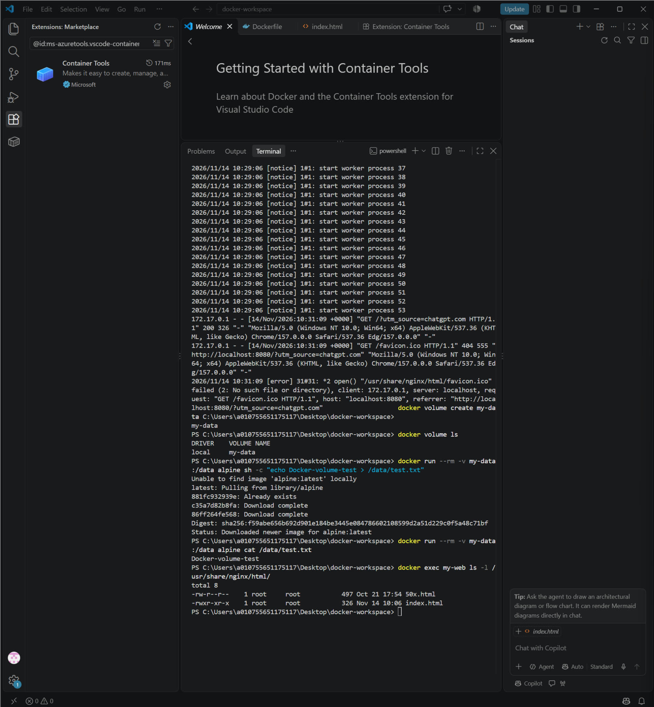

### 4.5 수정 후 이미지 재빌드

`index.html`의 favicon 지정 내용을 바꾸고 다음을 실행했다.

```powershell
docker build -t my-nginx .
docker stop my-web
docker rm my-web
docker run -d --name my-web -p 8080:80 my-nginx
```

이미지 빌드 시점에 `COPY`가 처리되므로, 로컬 HTML 수정 후에는 이미지를 다시 만들고 컨테이너를 교체해야 변경이 반영된다.

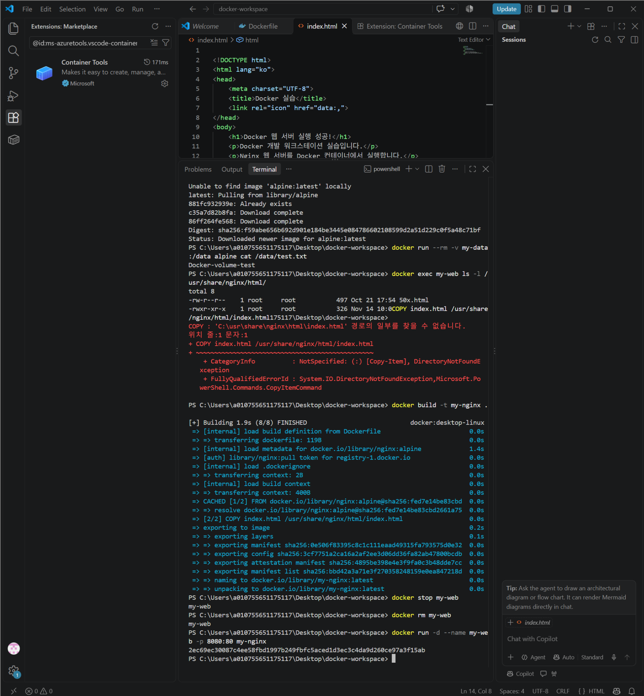

## 5. Docker 볼륨의 데이터 유지 검증

### 5.1 검증 목적과 생성

컨테이너는 일시적으로 만들어지고 삭제될 수 있다. 별도 Docker 볼륨을 연결하면 컨테이너 삭제 후에도 저장된 데이터를 재사용할 수 있는지 실험할 수 있다.

```powershell
docker volume create my-data
docker volume ls
```

실제 출력:

```text
DRIVER    VOLUME NAME
local     my-data
```

### 5.2 임시 컨테이너에서 데이터 저장

```powershell
docker run --rm -v my-data:/data alpine sh -c "echo Docker-volume-test > /data/test.txt"
```

`-v my-data:/data`는 `my-data` 볼륨을 컨테이너의 `/data`에 연결한다. `--rm`은 명령 종료 후 해당 임시 컨테이너를 자동 삭제한다. 저장 파일은 볼륨에 남는다.

### 5.3 새 컨테이너에서 읽기

```powershell
docker run --rm -v my-data:/data alpine cat /data/test.txt
```

실제 출력:

```text
Docker-volume-test
```

서로 다른 임시 컨테이너에서 동일한 볼륨을 사용해 기존 문자열을 확인했다. 따라서 **컨테이너 교체와 별도로 볼륨 데이터가 유지됨**을 검증했다.

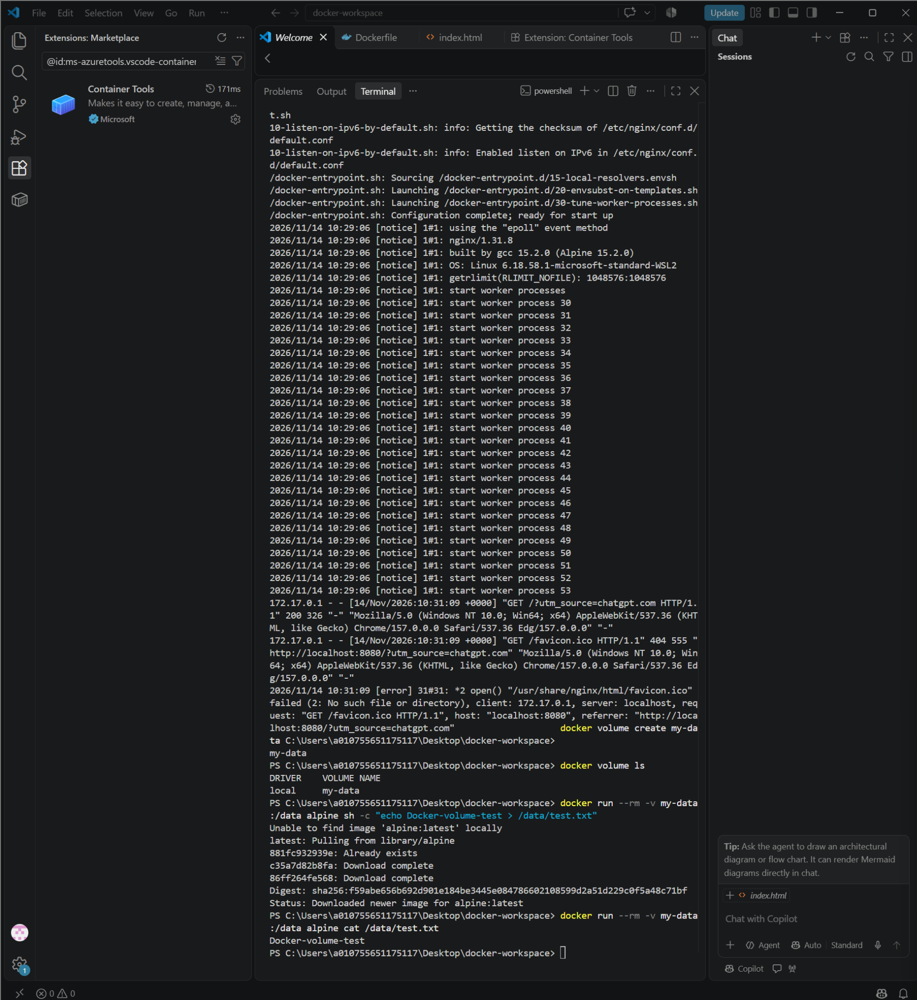

## 6. 트러블슈팅

### 6.1 사례 1 — Docker 엔진 연결 실패

**문제:** `docker info` 실행에서 Client 정보만 출력되고 Server 항목에는 다음 오류가 발생했다.

```text
failed to connect to the docker API at npipe:////./pipe/docker_engine
```

**원인 가설:** Docker Desktop 엔진이 실행되지 않았거나 해당 엔진과 연결되지 않은 상태였다.

**확인:** Docker Desktop 실행 상태를 확인했다.

**조치:** Docker Desktop을 열어 `Engine running`을 확인했다.

**재검증:** `docker info` 재실행 후 `Server Version: 29.9.2` 및 컨테이너 정보가 출력되었다.

**전후 화면:** [엔진 연결 오류](evidence/docker-error.png) · [정상 연결](evidence/docker-info.png)

### 6.2 사례 2 — `favicon.ico` 요청 시 HTTP 404

**문제:** 웹페이지 본문은 정상 응답(HTTP 200)이었으나 브라우저의 `GET /favicon.ico` 요청에 대해 HTTP 404가 발생했다.

**원인 가설:** Nginx가 제공하는 웹 디렉터리에 해당 아이콘 파일이 없었다.

**확인 명령어:**

```powershell
docker exec my-web ls -l /usr/share/nginx/html/
```

디렉터리에는 `50x.html`, `index.html`이 있었고 `favicon.ico`는 없었다.

**조치:** `index.html`의 `<head>`에 아래 항목을 추가했다.

```html
<link rel="icon" href="data:,">
```

이후 이미지를 다시 빌드하고 컨테이너를 교체했다.

**재검증:** 새 컨테이너에서 웹페이지 HTTP 200을 확인했고, 이번 접속의 로그에는 favicon 404가 다시 관찰되지 않았다. 이 결과만으로 모든 브라우저에서 404가 발생하지 않는다고 단정하지 않는다.

**오류 확인 화면**

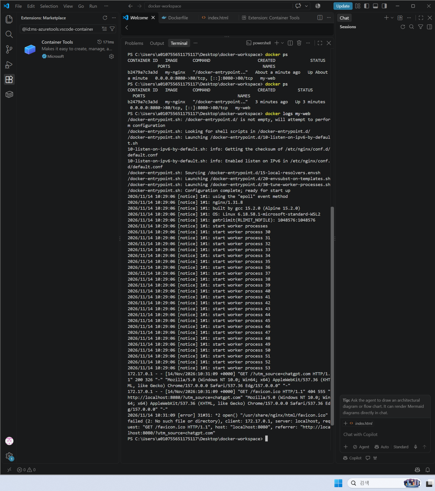

**수정 후 웹 서버 로그**

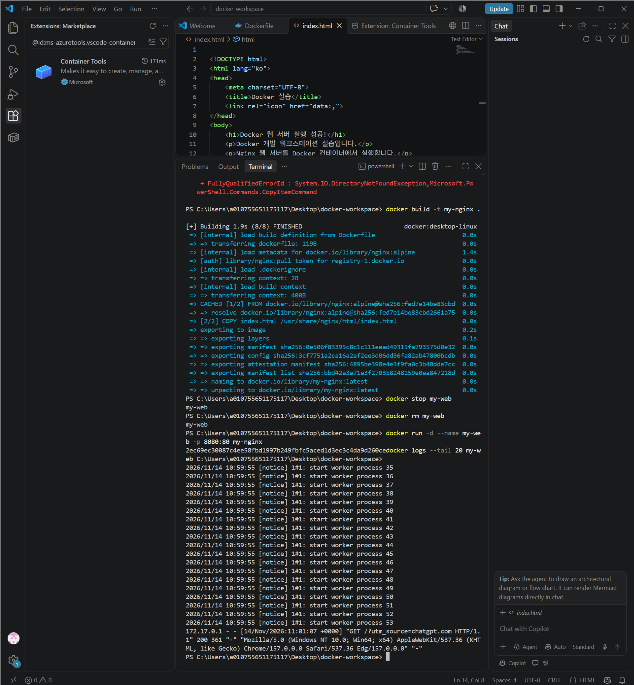

### 6.3 추가 사례 — PowerShell에 Dockerfile 전용 `COPY` 입력

**문제:** PowerShell에서 `COPY index.html /usr/share/nginx/html/index.html`을 실행하여 경로를 찾지 못한다는 오류가 발생했다.

**원인:** Dockerfile 내부 명령과 PowerShell 명령을 혼동했다. PowerShell에서는 `COPY`가 파일 복사 명령으로 해석된다.

**조치:** `COPY`는 Dockerfile에서만 사용하고 이미지 생성은 `docker build -t my-nginx .`로 실행했다.

**재검증:** 재빌드가 `8/8 FINISHED`로 완료되었다.

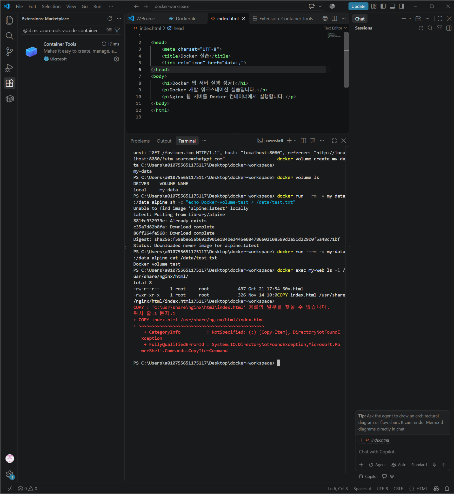

## 7. Git 버전 관리

```powershell
git --version
git init
git status
git add Dockerfile index.html
git commit -m "Initial Docker web server setup"
git status
```

- Git 버전: `2.56.0.windows.4`
- 최초 브랜치: `master`
- 최초 커밋의 짧은 ID: `a841331`
- 최초 커밋 대상: `Dockerfile`, `index.html` (2개 파일)
- 커밋 직후의 상태: `nothing to commit, working tree clean`

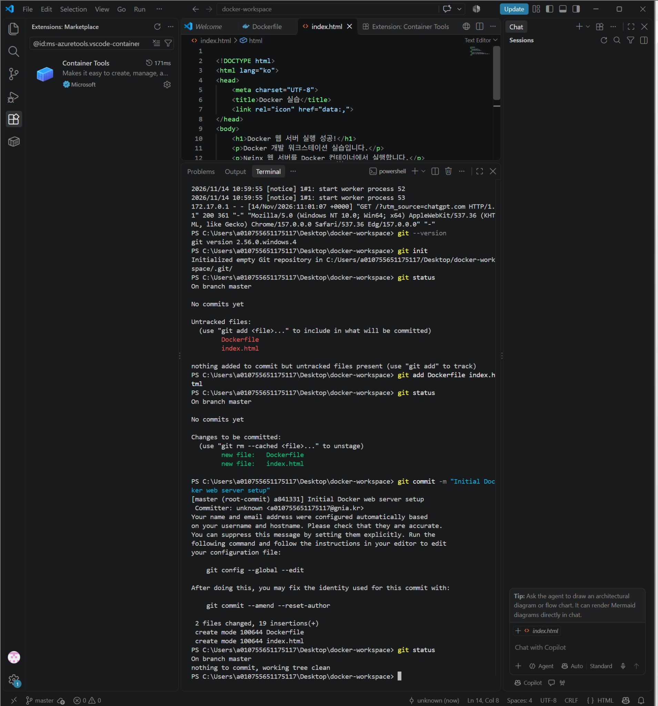

> **주의:** 이 `working tree clean` 기록은 `README.md` 및 `evidence` 파일을 추가하기 **이전** 결과다. README와 이미지를 Git에 추가한 뒤 새로 커밋하고 상태를 다시 확인해야 한다. 또한 Git이 작성자 이름/이메일을 자동 설정했다는 경고가 있었으므로 GitHub 공개 전 작성자 정보를 점검한다.

## 8. 실행 결과 및 증빙자료 모음

아래 링크는 실제 증빙 이미지로 연결되며, 검증 과정의 각 절에서도 이미지가 직접 표시된다.

| 증빙자료 | 확인 내용 | 사진 |
|---|---|---|
| Docker 엔진 연결 오류 | 초기 `docker info`에서 Server 연결 실패 | [오류 화면](evidence/docker-error.png) |
| Docker 서버 정상 연결 | `Server Version: 29.9.2` | [정상 화면](evidence/docker-info.png) |
| Docker 이미지 빌드 | `(8/8) FINISHED` | [빌드 화면](evidence/docker-build.png) |
| Docker 이미지 재빌드 | 파일 수정 후 이미지 재생성·컨테이너 교체 | [재빌드 화면](evidence/docker-rebuild.png) |
| 웹 서버 접속 | `localhost:8080` 페이지 출력 | [웹페이지 화면](evidence/web-success.png) |
| 컨테이너 로그 | HTTP 응답 코드 200 | [로그 화면](evidence/docker-logs.png) |
| 볼륨 데이터 유지 | `Docker-volume-test` 출력 | [볼륨 화면](evidence/volume-test.png) |
| Git 최초 커밋 | 커밋 `a841331` 생성 | [커밋 화면](evidence/git-commit.png) |
| favicon 오류 | HTTP 404 및 `favicon.ico` 누락 | [오류 화면](evidence/favicon-error.png) |
| favicon 수정 후 | 새 컨테이너의 HTTP 200 응답 | [수정 후 화면](evidence/favicon-fixed.png) |
| PowerShell COPY 오류 | Dockerfile 명령과 PowerShell 명령 혼동 | [오류 화면](evidence/copy-error.png) |

## 9. 결과 및 남은 과제

### 확인한 결과

Nginx 웹 서버를 Docker 이미지로 빌드해 컨테이너에서 실행했고, 호스트 포트 연결과 브라우저 HTTP 200을 검증했다. Docker 볼륨을 통해 임시 컨테이너 삭제 후 데이터가 유지되는 점을 확인했다. Docker 엔진 연결 오류와 favicon 요청 오류를 진단하고 조치했으며, Git으로 `Dockerfile`과 `index.html`의 초기 상태를 커밋했다.

### 추가로 완료해야 하는 내용

1. 파일 권한 검증(실행 명령, 출력, 설명)을 추가하여 원래 과제의 권한 항목을 완성한다.
2. README.md와 `evidence` 이미지 파일을 저장소에 추가하고 새 커밋을 만든다.
3. Git 작성자 정보에 개인 이메일이 노출되지 않도록 확인한다.
4. GitHub에 원격 저장소를 만들고 푸시한 후 README 내 이미지 표시를 검증한다.
5. 과제가 요구할 경우 다른 환경에서 빌드·실행 재현 여부를 확인한다.

### README 및 증빙자료 커밋에 사용할 명령어 (아직 실행 확인 전)

```powershell
git add README.md evidence/
git commit -m "Add README and Docker verification evidence"
git status
```

위 명령어는 실제로 실행하여 검증한 후 완료로 표시한다.

### 파일 권한 검증

실행 명령어:

docker exec my-web ls -l /usr/share/nginx/html/

실행 결과:

- 50x.html: rw-r--r--
- index.html: rwxr-xr-x
- 소유자: root
- 그룹: root

Docker 컨테이너 내부의 파일 소유자와
접근 권한을 확인하였다.
